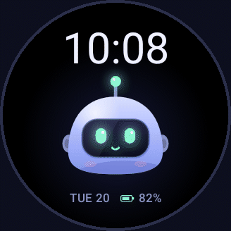
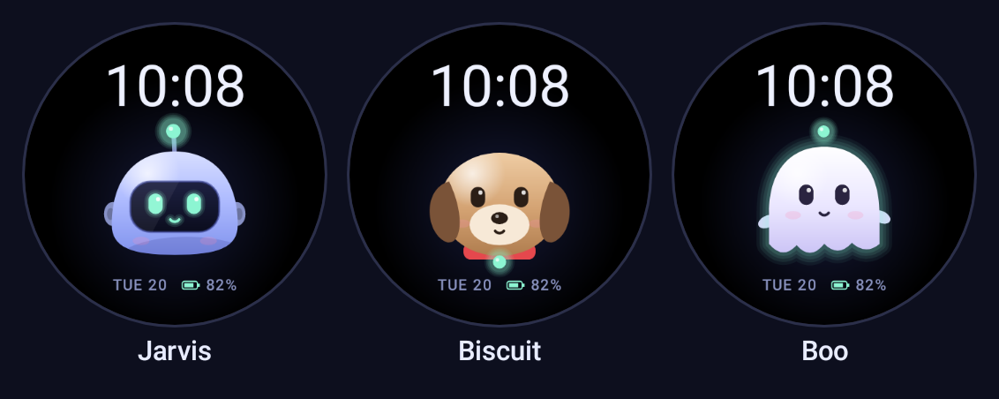
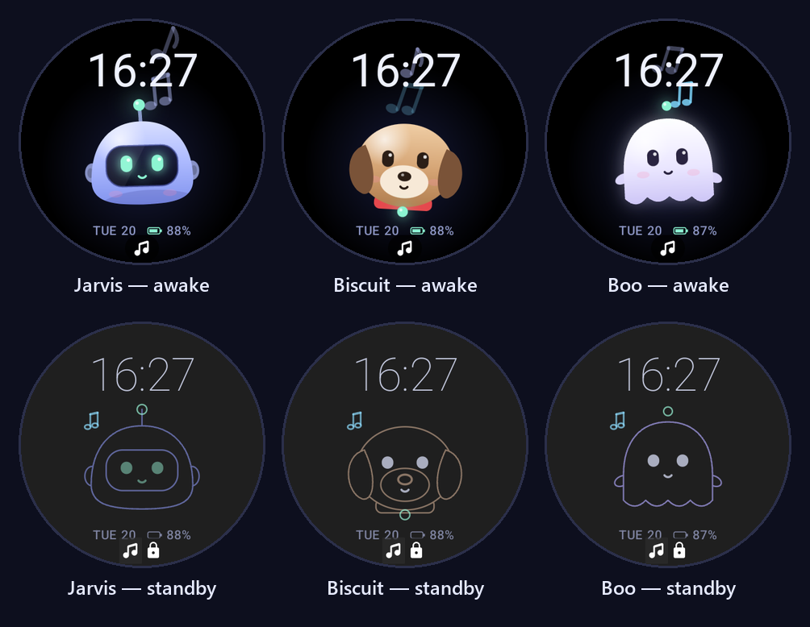
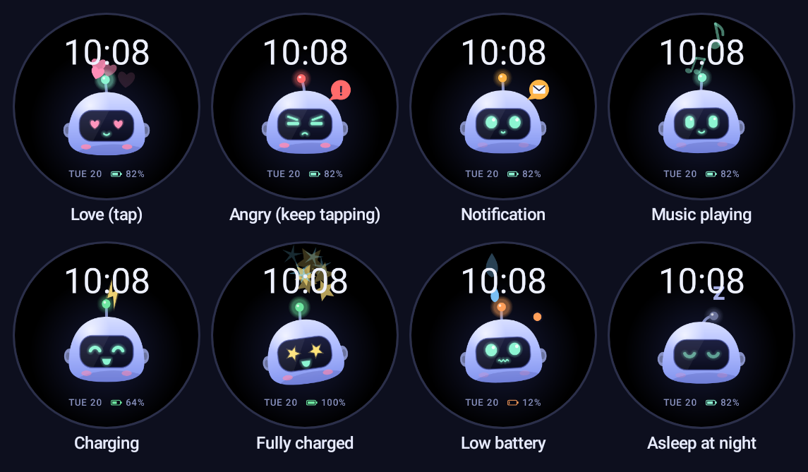
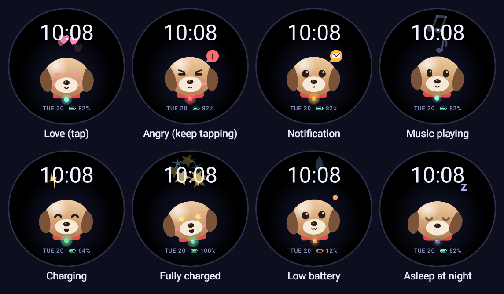
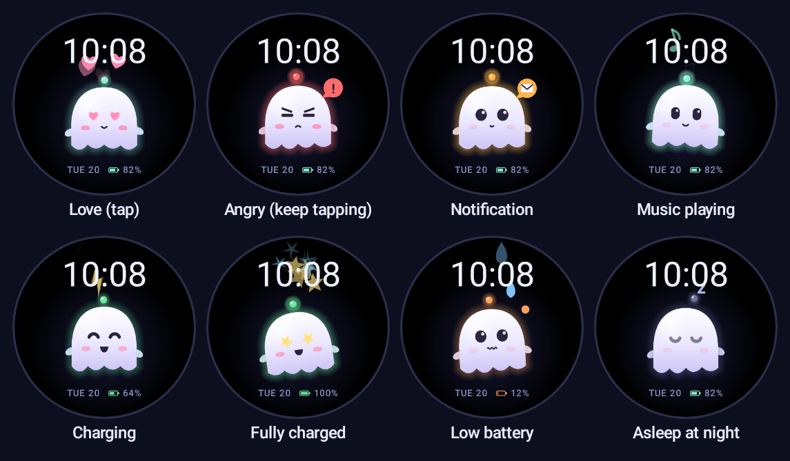
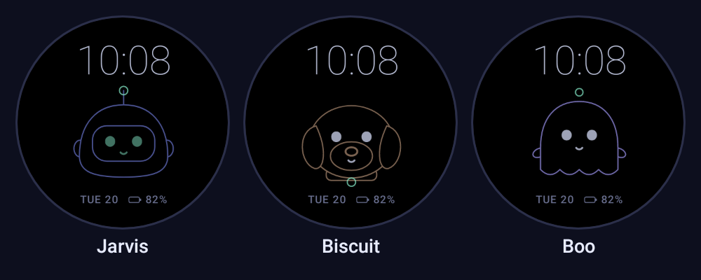

# Cute Companion

**A living, animated companion for your Wear OS watch face.** Pick a robot, a puppy or a little
ghost. It floats, blinks, looks around, gets bored when you ignore it, falls asleep at night,
bops along to your music, shows a letter when you have unread notifications, sweats when the
battery is low and celebrates when it's fully charged.

<p align="center"></p>

<p align="center"><a href="https://github.com/SekeNikola/WatchAI/releases/latest"><b>⬇️ Download the latest APK</b></a></p>



<p align="center"> </p>

<p align="center"><b>Jarvis</b> the robot · <b>Biscuit</b> the puppy · <b>Boo</b> the ghost</p>

---

## On a real watch

Screenshots from a Pixel Watch 2 (Wear OS 7) while music was playing. Top: awake. Bottom:
standby (always-on display).



## Features

- 🎭 **Three characters**, chosen from the watch face's *Customize* screen. All of them share
  the same personality and every reaction.
- 🌊 **Always alive**: a floating bob, random blinks (sometimes double), glances around, and smooth
  springy transitions between every mood with no hard cuts.
- 👆 **Tap it.** One or two taps bring hearts. Keep poking and it gets bored, then annoyed, then
  angry. Three quick taps while it's angry make it dizzy. Leave it alone and it calms back down.
- 🎵 **Music**: notes float out of its head and it sways while something is playing, on the
  watch or on your phone.
- ✉️ **Notifications**: a hop and a bouncing letter when one arrives, and a small letter badge
  for as long as anything is unread.
- 🔋 **Battery**: worried with sweat drops at 15% or below, lightning bolts while charging, and
  a spin, stars and a proud grin at 100%.
- 🌙 **Time of day**: a love-struck greeting on your first look in the morning, heavy eyelids in the
  evening, an occasional yawn late at night, and asleep with floating *z*'s after midnight.
- 😴 **Gets bored** after 30–60 s without attention: half-lidded, sighing, glancing away.
- 🖤 **Standby that's kind to your screen**: outline-only, dim, redrawn once a minute, shifting a
  couple of pixels each minute so nothing burns in.
- 🔒 **Private and light**: no internet, no microphone, no account. It only reads the *category* of a
  notification (never its content), and has no background polling.

## Meet the characters

### Jarvis, the robot
A periwinkle dome with a dark visor and a mint LED face. His antenna bulb is his mood light.



<details>
<summary><b>Biscuit, the puppy</b>: floppy ears, a cream muzzle, and a collar tag that lights up</summary>


</details>

<details>
<summary><b>Boo, the ghost</b>: a soft sheet with a waving hem and a glowing wisp above the head</summary>


</details>

### Standby (always-on)



The character keeps its mood in standby too: asleep at night, worried on low battery, a small
note while music plays, a letter while something is unread.

## Download

1. Open the **[latest release](https://github.com/SekeNikola/WatchAI/releases/latest)** and download **`CuteCompanion-<version>.apk`**
   under *Assets*.
2. Install it on your watch with the steps below. A watch can't download and install APKs by
   itself, so you install it from a computer over Wi-Fi with `adb`.

> Already installed a build you made yourself? Uninstall it first
> (`adb uninstall com.jarvis.watchface`), because the release APK is signed with a different key.

## Install

This is a sideloaded watch face (an APK you install yourself), not a Play Store listing.
See [Why not the Play Store?](#why-not-the-play-store).

**You need:** a Wear OS 3+ watch (round screens look best) and a computer with
[Android platform-tools](https://developer.android.com/tools/releases/platform-tools) (`adb`):
download the zip for Windows, macOS or Linux and unzip it. `adb` is inside.

### 1. Get the APK

Download it from [Releases](https://github.com/SekeNikola/WatchAI/releases/latest) (above), or build it yourself with JDK 17
and the Android SDK (Android Studio includes both):

```bash
./gradlew :watchface:assembleRelease      # watchface/build/outputs/apk/release/watchface-release.apk
```

### 2. Turn on debugging on the watch

1. **Settings → System → About → Versions**, then tap **Build number** 7 times.
2. **Settings → Developer options**: turn on **ADB debugging** and **Wireless debugging**.
3. Keep the watch and computer on the same Wi-Fi. Leave the *Wireless debugging* screen open
   while connecting, because watches turn Wi-Fi off quickly to save battery.

### 3. Pair, connect and install

```bash
# one time: "Pair new device" on the watch shows an IP:port and a 6-digit code
adb pair <watch-ip>:<pairing-port> <code>

# every time: the IP:port shown on the Wireless debugging screen
adb connect <watch-ip>:<port>
adb install -r CuteCompanion-1.0.1.apk
```

### 4. Set the face and pick a character

1. Long-press your current watch face, swipe to the end, tap **+ Add**, and choose **Cute Companion**.
2. Long-press it again → **Customize** → **Character** → *Jarvis*, *Biscuit* or *Boo*.

### 5. Optional: notifications and music

The letter badge, notification reactions and music notes need notification access. Wear OS
has no settings screen for that, so grant it with adb:

```bash
adb shell cmd notification allow_listener com.jarvis.watchface/com.jarvis.watchface.JarvisNotificationListener
# to undo: ... disallow_listener ...
```

Without it, everything else (moods, taps, battery, time of day) still works.

## Moods at a glance

| What happens | How the character reacts |
|---|---|
| Nothing | floats, blinks, looks around |
| 1–2 taps | ❤️ love: heart eyes, hearts, blush |
| 3–4 taps | 😑 bored: sighs |
| 5–6 taps | 😒 annoyed: slanted brow, little shake |
| 7+ taps | 😠 angry: frown, red light, shaking |
| 3 quick taps while angry | 😵 dizzy, then happy and over it |
| 30–60 s without a tap | 🥱 bored (asleep instead, late at night) |
| Notification arrives | 😮 hop, then a bouncing ✉️ |
| Anything unread | small ✉️ badge |
| Music playing | 🎵 notes and a gentle sway |
| Charging | ⚡ lightning bolts, happy face |
| 100% on the charger | ⭐ spin, sparks, star eyes, then a content glow |
| Battery ≤ 15% | 😰 worried, sweat drops, blinking orange light |
| Evening / night | heavier eyelids, yawns, asleep with *z*'s |
| First look in the morning | 😍 love |

## Good to know

- **Battery:** animation runs only while the screen is on: 20 fps while it's just floating, 30 fps
  during reactions, and 15 fps without glow when the watch's battery saver is on. The glow is drawn
  with cheap layered shapes instead of GPU blur (about 5 ms per frame on a Pixel Watch 2). Standby
  redraws once a minute. Notification and music detection use system callbacks, with no polling.
- **Notification card:** when a notification arrives, Wear OS shows its own card on top of the
  face. The reaction is held for a few seconds, so it's still playing when you swipe the card away.
- **Charging screen:** some watches (including Pixel) show a charging screen over any face. Swipe
  it away to see the lightning bolts.
- **Taps never open the assistant.** Use your watch's button for Gemini or Assistant.

### Why not the Play Store?

Since 2026 the Play Store only accepts watch faces built with Google's declarative
*Watch Face Format*, which can't run code. This face is drawn in code, which is what makes the
smooth mood blending, music and notification awareness and the tap moods possible, so it's
distributed as a sideloaded APK.

## For developers

### Build and test

```bash
./gradlew :watchface:assembleDebug        # debug build (adds an on-watch debug screen)
./gradlew :watchface:assembleRelease      # release build (see "Release signing" below)
./gradlew :watchface:testDebugUnitTest    # mood logic tests + renders every state
```

The screenshot test renders the real watch face with Robolectric's native graphics (the same
`android.graphics` code the watch runs) for every character, mood and standby pose. Output goes to
`watchface/build/screens/`, and the images in this README are regenerated into `docs/img/`.

### Release signing

Release builds are signed with the key described in a git-ignored `keystore.properties` at the
repo root (`storeFile`, `storePassword`, `keyAlias`, `keyPassword`). Without that file, release
builds fall back to the debug key, so anyone can still build and sideload.

### README images and GIF

`./gradlew :watchface:testDebugUnitTest` regenerates `docs/img/*.png`. The GIF frames are rendered
to `watchface/build/gif/` and assembled into `docs/img/demo.gif`.

### Try every mood (debug build)

Open **Cute Companion** from the watch's app list for buttons, or from a computer:

```bash
adb shell am broadcast -a com.jarvis.watchface.DEBUG -p com.jarvis.watchface --es cmd <command>
```

| Command | Effect |
|---|---|
| `character:dog` | `jarvis` / `dog` / `ghost` (`character:style` returns to your pick) |
| `state:angry` | hold any mood (`idle`, `bored`, `worried`, `charging`, `full`, `sleeping`, `dizzy`, …) |
| `emote:love` | `love`, `surprised`, `proud`, `wink`, `yawn`, `happy`, `annoyed` |
| `tap`, `bored`, `notify:remind` | simulate a tap, skip the bored timer, a notification |
| `music:on`, `unread:2` | fake music / unread count |
| `battery:10:false`, `hour:2` | fake battery level and charging, or time of day (`:real` to undo) |
| `lite:on` | force the battery-saver look (`lite:off`, `lite:auto`) |
| `clear` | back to live signals |

On Windows, `jarvis.ps1` wraps these: `.\jarvis.ps1 cmd state:angry`, `.\jarvis.ps1 install`.

### How it's built

```
avatar/      Reusable character module (plain android.graphics, no Wear dependencies)
  JarvisPose       the parameters one frame is drawn from (eyes, mouth, squash, tilt, colours…)
  JarvisRenderer   draws a pose for any Character; shared face, per-character bodies
  JarvisEngine     tweens, springs, blinks, emotes, particles (hearts, notes, bolts, z's…)
  BotState         the mood table: one row of parameters per mood
  Character        Jarvis, Dog, Ghost

watchface/   The Wear OS watch face (Jetpack Watchface, hardware canvas)
  JarvisCanvasRenderer   frame loop, standby, battery, debug input
  FacePainter            layout: time, character, date and battery
  MoodDirector           decides the mood from clock, battery, taps, notifications, music
  JarvisNotificationListener   unread count, notification reactions, music detection
  Styles + CharacterEditorActivity   the Character setting and its picker
```

Each frame, `MoodDirector` picks a mood, `JarvisEngine` eases every parameter toward it,
and `JarvisRenderer` draws the result. A mood is just a row of numbers (eye shape, mouth, colour, gaze,
tilt, float speed, eyelids, blush…), so moods blend into each other instead of switching.
The draw loop allocates nothing: paints, paths and shaders are reused.

### Add a mood

1. Add a row to `BotState.kt`.
2. Optional entrance (hop, spin, shake): a case in `JarvisEngine.setState`.
3. Decide when it happens in `MoodDirector.choose()`.
4. Run the screenshot test to see it.

### Add a character

1. Add it to `Character.kt`.
2. Draw its body in `JarvisRenderer.drawCritter`, and say where the shared face sits with `faceSpec(...)`.
3. Add a name and icons in `Styles.kt` and `strings.xml` (keep the `_small` icons ~64 px; the
   style schema must stay under 50 KB, and a test checks it).
4. Run the screenshot test. It renders the character's gallery and its picker icons.

## Credits

The Jarvis character and animation engine come from the *Jarvis2.0* desktop assistant, whose
engine is based on [BotEngine / coucou](THIRD_PARTY_NOTICES-coucou.txt) (MIT, © 2026 Louis Raillé).
Biscuit and Boo were designed for this project using the same parts.

## License

[MIT](LICENSE) © 2026 Nikola Seke. The animation engine includes code from BotEngine / coucou,
also MIT, see [THIRD_PARTY_NOTICES-coucou.txt](THIRD_PARTY_NOTICES-coucou.txt).
