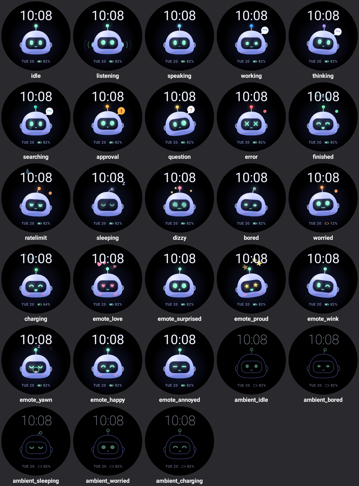

# Jarvis watch face (Wear OS)

The Jarvis avatar from Jarvis2.0 living on the watch as an animated watch face.
Avatar only: Gemini (already on the watch) stays the assistant. Personal use, sideloaded.
No companion app, no mic, no LLM calls, no network.



## Architecture

```
avatar/      Reusable character module. Plain android.graphics, no Wear deps.
  JarvisPose      the parameters one frame is drawn from (eyes, mouth, squash, tilt, colour…)
  JarvisRenderer  draws a pose; 1:1 port of Jarvis2.0 desktop/src/jarvis/draw.ts
  JarvisEngine    tweens, springs, blinks, emotes, particles; port of engine.ts
  BotState        the emotion table (one row of parameters per emotion) + Emote
  Ease            easing curves from core/anim.ts

watchface/   The Wear OS app (Jetpack Watchface, CanvasRenderer2, hardware canvas).
  JarvisWatchFaceService   entry point, tap listener
  JarvisCanvasRenderer     frame loop, ambient transitions, battery + debug receivers
  FacePainter              layout: time, Jarvis, date + battery; interactive and ambient
  MoodDirector             decides the emotion from clock, battery, taps, wake, notifications
  AssistantLauncher        tap → system assistant intent
  JarvisNotificationListener  optional; notification → perk up / remind
  AvatarBus                in-process command mailbox (debug, notifications)
  src/debug/DebugActivity  on-watch debug screen (debug builds only)
```

**Frame flow:** `render()` drains AvatarBus, then `MoodDirector.update()` picks a `BotState`,
then `JarvisEngine.update(t)` eases every parameter toward that state, then
`engine.pose()` fills one reused `JarvisPose`, then `JarvisRenderer.draw()`.

**Fluid transitions:** every numeric parameter (gaze, tilt, squash, eye scale, float
speed and amplitude, lids, brightness, blush, bulb colour) eases toward the new state with
the desktop's exponential smoothing, and the antenna is a damped spring. Eye and mouth
shapes are discrete, so a change squashes the old shape out (80 ms) and springs the new
one in (160 ms) instead of cutting.

**Performance:** no allocations in the steady-state draw loop. Paints, paths, rects and
shaders are reused, shaders are rebuilt only when the size changes, particles are a
fixed pool and strings are rebuilt once a minute. Interactive mode draws at about 60 fps
(`FRAME_MS`). Ambient mode draws once a minute: black background, outline-only Jarvis,
no glow, no gradients and no animation. It shifts 2 px each minute for burn-in safety and
drops anti-aliasing on low-bit screens.

## Emotions and what triggers them

| Emotion | Trigger |
|---|---|
| idle | default: floating bob, random blinks (sometimes double), occasional look-around |
| listening | tap on Jarvis: hop, ear rings, for a fixed 4 s (timed, *not* Gemini's real state) |
| approval (remind) | a reminder/alarm/event notification (6 s), or a message/call (3 s) |
| charging | on the charger. Spins once with sparks on plug-in |
| worried | battery at or below 15% and not charging |
| bored | 30–60 s (random) with no tap. Sighs and the occasional yawn |
| sleeping | the "bored" timeout during the drowsy hours (about 23:00–05:30) |
| drowsy idle | from 21:00 the lids get heavier and the face dims (desktop curve) |
| love emote | first wrist raise of the morning (05–11) |
| yawn emote | wrist raise late at night (50%, at most every 20 min) |
| surprised emote | Jarvis "notices you" 1.4 s after a wrist raise while bored or asleep, and on notifications |

All the original desktop states (working, thinking, searching, question, error, finished,
ratelimit, dizzy, speaking) and emotes (love, surprised, proud, wink, yawn, happy, annoyed)
are ported and can be triggered from debug.

**Proposed designs** (not in the original, built only from its existing parts; tune in
`BotState.kt`):
- **bored**: narrowed eyes at 75% lids, glancing down-left, flat mouth, slight tilt, slow
  shallow float, droopy antenna, grey-mint bulb.
- **worried**: wide eyes looking up, wavy mouth, sweat drops, nervous quick float, amber
  blinking bulb, amber dot badge.
- **charging**: happy eyes and grin, green bulb, breathing, blush. The entrance reuses
  "finished".

## How to add a new emotion

1. Add a row to `avatar/.../BotState.kt`. Every field is a parameter (eye, mouth, badge,
   colour, lookX/lookY, tilt, floatSpeed/floatAmp, lids, dim, blush, antennaRest, sweat, zz…).
2. Optional one-shot entrance (hop, spin, shake): add a case in `JarvisEngine.setState`.
3. Optional bulb pulse pattern: add a case in `JarvisEngine.pose`.
4. Decide when it happens in `MoodDirector.choose()`.
5. Ambient look: add a case in `FacePainter.ambientPose`.
6. Run the screenshot test to see it (below). It appears in the debug screen automatically.

New eye or mouth *shapes* go in `Eye`/`Mouth` (`JarvisPose.kt`) and `JarvisRenderer.drawEye/drawMouth`.

## Build and run

Requirements: Android SDK, JDK 17 (Android Studio's `jbr` works). No emulator is needed.

```powershell
$env:JAVA_HOME = "C:\Program Files\Android\Android Studio\jbr"
.\gradlew :watchface:assembleDebug          # APK: watchface/build/outputs/apk/debug/
.\gradlew :watchface:testDebugUnitTest      # mood logic tests + renders every state
```

The screenshot test renders the real face for every state, emote and ambient pose with
Robolectric's native graphics (the same `android.graphics` code that runs on the watch) into
`watchface/build/screens/`, with a `_contact_sheet.png` overview.

### Sideload to the watch over Wi-Fi

1. Watch: **Settings → System → About → Versions**, tap **Build number** 7 times.
2. **Settings → Developer options**: turn on **ADB debugging** and **Debug over Wi-Fi**
   (Wear OS 3+: **Wireless debugging**). Keep the watch on the same Wi-Fi as the PC.
   Wear OS drops Wi-Fi when it's on Bluetooth to the phone, so keep that screen open
   (or turn Bluetooth off briefly) while connecting.
3. Wear OS 3+ needs pairing once: tap **Pair new device** and note the pairing IP:port and code.
   ```powershell
   adb pair 192.168.0.29:<pair-port> <code>
   ```
4. Connect (the port on the Wireless debugging screen changes every time it's toggled):
   ```powershell
   .\jarvis.ps1 connect 192.168.0.29:40857
   .\jarvis.ps1 install      # builds, installs, sets as the watch face
   ```
   If the face isn't set automatically, long-press the current face, swipe to the end,
   tap **+**, and pick **Jarvis**.

### Debug: trigger any state

On the watch (debug build), open **Jarvis debug** from the app list. Each button
applies a command and returns to the face.

From the PC:

```powershell
.\jarvis.ps1 cmd state:bored        # any BotState: idle, listening, worried, charging, sleeping, dizzy…
.\jarvis.ps1 cmd emote:love         # love, surprised, proud, wink, yawn, happy, annoyed (optional :seconds)
.\jarvis.ps1 cmd clear              # release holds, back to live signals
.\jarvis.ps1 cmd bored              # skip the bored timer
.\jarvis.ps1 cmd notify:remind      # remind | message | other
.\jarvis.ps1 cmd battery:10:false   # fake battery (level:charging), battery:real to undo
.\jarvis.ps1 cmd hour:2             # fake time of day for moods, hour:real to undo
.\jarvis.ps1 cmd tap                # listening pose without launching the assistant
.\jarvis.ps1 cmd assist             # launch the assistant without the pose
.\jarvis.ps1 shot bored             # screenshot from the watch into screens/
.\jarvis.ps1 log                    # logs (which assistant intent worked, commands)
```

The raw adb form is
`adb shell am broadcast -a com.jarvis.watchface.DEBUG -p com.jarvis.watchface --es cmd state:bored`.
The debug receiver and screen exist only in debug builds.

## Tap to assistant

Tapping Jarvis plays the listening pose, then after 450 ms (so the perk-up is visible)
starts the first intent that resolves, in this order: `ACTION_VOICE_COMMAND`,
`ACTION_ASSIST`, `android.intent.action.VOICE_ASSIST`. The **Jarvis debug** screen lists
what each one resolves to on your watch, and `.\jarvis.ps1 log` shows which one launched.
The watch face gets no signal back from Gemini, so the pose is a fixed 4 s. Gemini covers
the face while it's open.

## Notifications (optional)

`JarvisNotificationListener` makes Jarvis perk up (surprised) and show the remind pose
when a reminder, alarm, calendar event, message or call notification arrives. If the screen
is in ambient, he shows it on the next wrist raise (within 10 min).

- **Permission:** notification access (`BIND_NOTIFICATION_LISTENER_SERVICE`). There's no
  runtime prompt. It does nothing until you grant it, and Wear OS has no settings screen for
  it, so use adb: `.\jarvis.ps1 notify-access` (undo: `notify-revoke`). Only the notification
  *category* is read, never its content.
- **Battery:** close to zero. The system calls the listener only when a notification is
  posted, so there's no polling or wakelock. The face reacts on its next frame (interactive)
  or on the next wake (ambient). It never forces the screen on.

Calendar and timer awareness are covered by the same notifications (calendar reminders and
finished timers post reminder/alarm notifications). A separate calendar query would need
`READ_CALENDAR` plus periodic work, so it was left out.

## Credits

Character and engine ported from Jarvis2.0 (`desktop/src/jarvis`), whose engine is based
on BotEngine/coucou (MIT, © 2026 Louis Raillé). See Jarvis2.0 `THIRD_PARTY_NOTICES-coucou.txt`.
